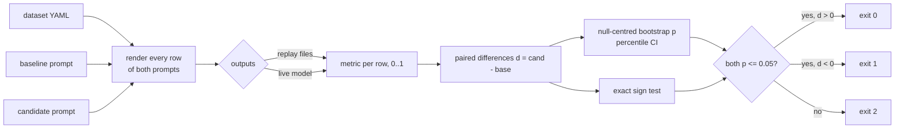

# prompt-eval-toolkit

[](https://github.com/darrshangovender/prompt-eval-toolkit/actions/workflows/tests.yml)
[](LICENSE)
[](https://python.org)
[](prompt_eval/stats.py)

> A small CLI that scores two versions of a prompt on the same dataset and says whether the difference is real: a paired-bootstrap p-value and interval, an exact sign-test floor, and an exit code a CI job can act on. The statistics are checked against known answers and scipy, and run offline on a bundled example.

**Why this exists.** Prompts get tweaked weekly, and "this output looks better" is how regressions ship. The unglamorous fix is to treat a prompt change like a code change: run an eval, read a number, merge only if it holds up. The part that is easy to get wrong is the last step. Forty rows and a 5-point gain is usually noise, and a naive bootstrap will happily print `p = 0.000` on two rows. This repository is the comparison step done carefully, with every statistical claim backed by a script you can run.

Pairs with [prompt-versioner](https://github.com/darrshangovender/prompt-versioner), which stores and routes the version this tool decides to promote.

---

## Quick start

No API key, no network, no model: the example compares two prompt versions from **recorded outputs** (60 templated invoice texts, `data/example_dataset.yml`; the outputs are simulated, see Results).

```bash
pip install -e ".[dev]"
prompt-eval compare \
    --baseline prompts/extractor_v1.txt \
    --candidate prompts/extractor_v2.txt \
    --dataset data/example_dataset.yml \
    --baseline-outputs data/example_outputs_baseline.json \
    --candidate-outputs data/example_outputs_candidate.json
```

```text
Comparing  baseline=extractor_v1.txt   candidate=extractor_v2.txt
Dataset    example_dataset.yml  (60 examples)
Metric     exact_match
Outputs    replayed from files (no model called)

Baseline:    0.400  (24 / 60)
Candidate:   0.917  (55 / 60)
Δ            +0.517  (+129.2% relative)
Pairs        candidate better on 32, worse on 1, same on 27
p-value      0.0002  (paired bootstrap, B=5000, seed 42; exact sign test p<0.0001; both must be <= 0.05)
95% CI       +0.383..+0.650

VERDICT: Candidate wins. Promote.
```

The exit code is the verdict: `0` promote, `1` regression, `2` inconclusive, `3` could not run (bad input, no model configured, a model error). Add `--json` for one machine-readable object, `--metric contains` to accept an answer wrapped in a sentence, `--seed` and `--n-bootstrap` to change the resampling.

As a library, with any callable as the model:

```python
from pathlib import Path

from prompt_eval.metrics import REGISTRY
from prompt_eval.runner import load_dataset, load_outputs
from prompt_eval.stats import compare

data = Path("data")
examples = load_dataset(data / "example_dataset.yml")
base = load_outputs(data / "example_outputs_baseline.json", expected_rows=len(examples))
cand = load_outputs(data / "example_outputs_candidate.json", expected_rows=len(examples))
metric = REGISTRY["exact_match"]

r = compare(
    [metric(o, e.expected) for o, e in zip(base, examples, strict=True)],
    [metric(o, e.expected) for o, e in zip(cand, examples, strict=True)],
)
print(f"delta={r.delta:+.3f}  p={r.p_value:.5f}  sign_p={r.sign_p_value:.1e}  "
      f"CI=({r.ci_low:+.3f}, {r.ci_high:+.3f})  significant={r.significant}")
```

```text
delta=+0.517  p=0.00020  sign_p=7.9e-09  CI=(+0.383, +0.650)  significant=True
```

Against a live model (optional; needs a key and an SDK: `pip install -e ".[anthropic]"` or `".[openai]"`), leave out the two `--*-outputs` flags. Every row of both prompts is rendered first, so a bad placeholder fails before any call is paid for:

```bash
export ANTHROPIC_API_KEY=...        # or OPENAI_API_KEY; MODEL overrides the default model name
prompt-eval compare --baseline prompts/extractor_v1.txt --candidate prompts/extractor_v2.txt \
    --dataset data/invoices.yml
```

## How it works



1. `load_dataset` reads the YAML into `Example(variables, expected)` rows and refuses a malformed row, a null `expected` and the YAML trap where an unquoted `NO` becomes `False`.
2. `render` fills `{{ name }}` placeholders strictly: a missing variable, an unused variable and a brace pair that is not a plain name (`{{ user.name }}`) are all errors, so a typo cannot silently score 0 on every row. Values are inserted as text and never re-expanded.
3. The outputs come from `--*-outputs` files or from `default_model_caller` (Anthropic if its key is set, else OpenAI).
4. The metric scores each row 0..1. `exact_match` and `contains` trim, Unicode-normalise (NFC) and case-fold.
5. `compare` works on the paired differences `d = candidate - baseline`:
   - **Interval:** resample the pairs with replacement `B` times (default 5000), take the 2.5th and 97.5th percentiles of the resampled mean.
   - **p-value:** a bootstrap *test of "the mean difference is zero"*. The differences are centred first so the resampling follows the null, then `p = (1 + #{|mean(d*) - mean(d)| >= |mean(d)|}) / (B + 1)`. It is never exactly 0.
   - **Sign test:** the exact two-sided sign test on the pairs that differ (the exact McNemar test for 0/1 scores).
6. The change counts as real (`significant`) only if **both** p-values are at most 0.05. With a seeded generator the verdict reproduces exactly.

## Results

Everything below is printed by two scripts you can run: `python benchmarks/verify_stats.py` (about 2.5 minutes; `--quick` is a noisier 40-second smoke run) and the `prompt-eval` command above. The bundled example and the simulated datasets are **SYNTHETIC**: no real model, invoice or client is involved.

### The example data

`benchmarks/make_example_data.py` generates `data/example_dataset.yml` (60 templated invoice texts; 10 have no invoice number and expect `NONE`) and two sets of *simulated* model outputs. The "baseline" often wraps its answer in a sentence (30% of the time) and says "No invoice number found." instead of `NONE`; the "candidate" answers bare. The probabilities are written in the script and the seed is fixed; the first draw is the one committed. It exists so the comparison runs offline on paired data with a real, moderate difference. It says nothing about any real prompt or model.

### 1. Known cases

The sign test against a worked-by-hand binomial tail, the unanimous case against `2^(1-n)`, and the bootstrap p-value against the **exact** bootstrap distribution of a five-row example (all 3,125 resamples enumerated; the script's estimate uses 200,000):

| case | expected | where from | `prompt_eval` | scipy |
|---|---|---|---|---|
| sign test, 10 wins / 2 losses | 0.0386 | 2 x (66+12+1) / 4096, by hand | 0.0386 | 0.0386 |
| 2 unanimous wins | 0.5000 | 2^(1-2) | 0.5000 | 0.5000 |
| 20 unanimous wins | 1.91e-06 | 2^(1-20) | 1.91e-06 | 1.91e-06 |
| 5 rows, exact bootstrap by enumeration (3,125 resamples) | 0.1648 | enumerated | 0.1645 | n/a |

### 2. The bundled example against scipy

Our p-value (20,000 resamples) next to the same estimator run through `scipy.stats.bootstrap` (100,000 resamples), and three different tests of the same hypothesis:

| metric | n | baseline | candidate | wins/losses | p (ours) | p (scipy bootstrap) | p (paired t) | p (sign-flip permutation) | p (exact binomial) | sign p (ours) |
|---|---|---|---|---|---|---|---|---|---|---|
| exact_match | 60 | 0.400 | 0.917 | 32/1 | 5.00e-05 | 1.00e-05 | 4.51e-10 | 2.00e-05 | 7.92e-09 | 7.92e-09 |
| contains | 60 | 0.733 | 0.933 | 14/2 | 0.0012 | 0.0016 | 0.0020 | 0.0045 | 0.0042 | 0.0042 |

| metric | 95% CI (ours) | 95% CI (scipy percentile bootstrap) |
|---|---|---|
| exact_match | +0.383 .. +0.650 | +0.383 .. +0.650 |
| contains | +0.083 .. +0.317 | +0.083 .. +0.317 |

How to read it. On `exact_match` no resample out of 20,000 (ours) or 100,000 (scipy) is as extreme as the data, so each prints its floor, `1/(B+1)`: 5.0e-05 and 1.0e-05. That is agreement, not a discrepancy. On `contains` the two bootstraps agree within Monte Carlo error (0.0012 vs 0.0016) and the intervals match to three decimals. The bootstrap and the t-test are less conservative than the exact tests (0.0012 and 0.0020 against 0.0042 and 0.0045) because only 16 pairs differ and the exact tests are discrete. The interval for `exact_match` excludes zero by a wide margin either way.

### 3. Calibration: how often a no-difference dataset is called significant

1,000 simulated datasets per row, the two prompts identical in truth, `B = 499`. The target is at most 0.05 (Monte Carlo standard error about 0.007).

| differences | n | bootstrap | bootstrap+sign (significant) | paired t-test | sign test |
|---|---|---|---|---|---|
| 0/1 scores (differences -1, 0, +1) | 10 | 0.019 | 0.000 | 0.019 | 0.000 |
| 0/1 scores (differences -1, 0, +1) | 20 | 0.033 | 0.004 | 0.043 | 0.004 |
| 0/1 scores (differences -1, 0, +1) | 40 | 0.031 | 0.014 | 0.035 | 0.014 |
| 0/1 scores (differences -1, 0, +1) | 100 | 0.052 | 0.038 | 0.064 | 0.039 |
| continuous, symmetric (normal) | 10 | 0.119 | 0.019 | 0.057 | 0.023 |
| continuous, symmetric (normal) | 20 | 0.074 | 0.027 | 0.048 | 0.039 |
| continuous, symmetric (normal) | 40 | 0.065 | 0.024 | 0.056 | 0.041 |
| continuous, symmetric (normal) | 100 | 0.049 | 0.018 | 0.049 | 0.041 |
| continuous, skewed (exponential) | 10 | 0.151 | 0.063 | 0.112 | 0.078 |
| continuous, skewed (exponential) | 20 | 0.102 | 0.065 | 0.081 | 0.203 |
| continuous, skewed (exponential) | 40 | 0.088 | 0.068 | 0.076 | 0.353 |
| continuous, skewed (exponential) | 100 | 0.072 | 0.052 | 0.068 | 0.703 |

- **For 0/1 scores, the metrics this repository ships, the decision (`bootstrap+sign`) never exceeds 0.038.** The bootstrap alone is also at or under about 0.05 there.
- **The sign floor is doing real work at small n.** On continuous scores the bootstrap alone raises a false alarm 12% of the time at n = 10 and 7% at n = 20; with the floor it is 1.9% and 2.7%. That is the reason it exists.
- **Skewed continuous scores are not fully covered.** The decision still reaches 0.063-0.068 at n = 10-40, about two standard errors over 0.05, in line with the paired t-test (0.076-0.112). Do not read a borderline p on a heavily skewed metric as precise.
- The sign-test column on skewed data (0.08-0.70) is not a failure of that test: it tests whether the *median* difference is zero, and the exponential differences have mean 0 but median below 0. It is shown because `significant` needs it.

### 4. Power: how often a true improvement is called significant

1,000 simulated datasets per row, same settings. "Win rate 20% vs loss rate 10%" means 20% of pairs favour the candidate, 10% favour the baseline and the rest tie (a 10-point net gain on 0/1 scores).

| true difference | n | bootstrap | bootstrap+sign (significant) | paired t-test | sign test |
|---|---|---|---|---|---|
| win rate 20% vs loss rate 10% | 20 | 0.108 | 0.051 | 0.115 | 0.051 |
| win rate 20% vs loss rate 10% | 40 | 0.201 | 0.148 | 0.202 | 0.148 |
| win rate 20% vs loss rate 10% | 100 | 0.412 | 0.345 | 0.445 | 0.345 |
| mean difference 0.4 SD | 20 | 0.471 | 0.251 | 0.405 | 0.271 |
| mean difference 0.4 SD | 40 | 0.721 | 0.434 | 0.694 | 0.454 |
| mean difference 0.4 SD | 100 | 0.974 | 0.843 | 0.970 | 0.844 |

- **A real 10-point gain on 0/1 scores is usually missed at these sizes**: 15% power at 40 rows, 35% at 100 (the script does not go higher). Only the pairs that differ carry information, so paired binary data needs many rows; that is the arithmetic, not a flaw of the tool. An `Inconclusive` verdict on a small dataset means "collect more rows", and the CLI says so.
- **The sign floor costs power, most on continuous scores**: at n = 40 and a 0.4 SD effect, 43% instead of 72%. For 0/1 scores the cost is smaller (15% instead of 20% at n = 40). It is the price of a gate that cannot promote a prompt on two rows or on a handful of lucky pairs.
- The bootstrap alone and the paired t-test detect effects at nearly the same rate, as they should.

## Design decisions

| Decision | Why |
|---|---|
| **A bootstrap *test*, not "the fraction of resamples below zero"** | Resampling the raw differences gives a confidence interval; a p-value needs the resampling distribution to obey the null, so the differences are centred first. The older fraction-below-zero form is a z-like heuristic; this one is checked against exact enumeration and scipy above. |
| **Add-one p-value, exact fallback for unanimous pairs** | `(1 + extreme) / (B + 1)` is never 0. When every difference is identical every centred resample is exactly zero, so the bootstrap has no spread; the exact sign-flip value `2^(1-n)` is used instead. |
| **`significant` needs the bootstrap and the exact sign test** | The bootstrap leans on the sample resembling its population, which fails for a handful of pairs (table 3). The sign test is exact at any n. Requiring both costs power (table 4) and buys a gate that holds the 5% level on the shipped 0/1 metrics. |
| **Three outcome exit codes plus one for "could not run"** | A CI job must tell "worse" from "not enough data" from "the job did not run". argparse's own usage-error code is 2, which would read as inconclusive, so usage errors exit 3. |
| **Replayable outputs** | `--baseline-outputs` / `--candidate-outputs` make the comparison reproducible offline, and let you record model outputs once and re-test the statistics without paying again. |
| **Prompts are plain text, datasets plain YAML** | Reviewable in a normal PR diff. |
| **The model caller is a `Callable[[str], str]`** | Bring your own client, retries and mocking. The standard library does the statistics; SDKs are optional extras. |
| **Seeded RNG, seed echoed in the output** | A CI failure is reproducible, and the printed seed lets someone else reproduce it. |

## Limitations

- **The bundled example is synthetic.** The outputs are simulated from stated probabilities; the comparison on it demonstrates the statistics, not the quality of any prompt or model. `data/invoices.yml` (4 rows) is a smoke-test set for the live path.
- **The metrics are string comparisons.** Any paraphrase, reordering or extra prose scores 0 under `exact_match`. The tool is honest on extraction and classification, and close to useless on free-form generation. There is no LLM-as-judge metric.
- **Power is modest at the dataset sizes people actually use** (table 4): a 10-point gain on a 0/1 metric is detected only about a third of the time at 100 rows, and 15% of the time at 40. The verdict is conservative by design.
- **The sign floor discards magnitude information.** On continuous metrics it costs a large share of the power the bootstrap alone has (table 4). If you score on a continuous scale and have a large dataset, the `p_value` field alone is available on `CompareResult`; the CLI always applies both.
- **Skewed continuous metrics over-reject slightly** even with the floor (table 3), like the paired t-test. The percentile interval is not BCa and is biased at small n.
- **One metric at a time, one comparison at a time.** No correction for looking at several metrics or several candidates; comparing ten prompts against one baseline at 0.05 would, if the comparisons were independent, find at least one false winner 40% of the time (1 - 0.95^10).
- **Serial, uncached, unretried model calls.** N rows x 2 prompts = 2N sequential requests, re-paid on every run, with no backoff; a model error ends the run with exit 3 and no partial results. Record outputs once and replay them.
- **`render()` is strict in both directions**: a dataset variable the prompt does not use is an error, so metadata columns cannot sit beside the inputs, and a literal `{{ ... }}` in a prompt cannot be expressed.
- **No cost, token or latency accounting**, although the tool exists to gate changes that move all three.
- **Not run against a live model in this repository.** The Anthropic and OpenAI callers are tested with fake clients that return the SDK's response shape; no real call was made.

## Project layout

```
prompt-eval-toolkit/
├── prompt_eval/
│   ├── cli.py            # `prompt-eval compare`, exit codes, replay and JSON modes
│   ├── runner.py         # dataset/outputs loading, {{var}} rendering, model dispatch
│   ├── stats.py          # null-centred paired bootstrap, percentile CI, exact sign test
│   └── metrics/          # exact_match · contains · REGISTRY
├── benchmarks/
│   ├── make_example_data.py   # regenerates the SYNTHETIC example (and --check)
│   └── verify_stats.py        # known cases, scipy cross-checks, calibration, power
├── data/                 # example_dataset.yml · example_outputs_*.json (SYNTHETIC) · invoices.yml
├── prompts/              # two demo prompt versions
└── tests/                # 237 tests, offline, no API keys
```

A dataset row is just:

```yaml
- variables:
    text: "Invoice 12345 dated 2025-01-15"
  expected: "12345"
```

(Quote `expected` if it could be read as a boolean: unquoted `NO` or `yes` is refused.)

## Tests

```bash
pytest tests/          # 237 passed, offline, no keys
ruff check .           # 0 findings
make bench             # known cases, scipy cross-checks, calibration, power (about 2.5 minutes)
```

Covered: the sign test against hand-worked and scipy values; the bootstrap p-value against the exact enumerated distribution and `scipy.stats.bootstrap`; the interval against scipy; a calibration run that fails if the false-alarm rate leaves its bound (and a check that a one-sided p-value *would* leave it); Hypothesis properties (swapping prompts negates delta and mirrors the interval, a shift of both prompts changes nothing, rescaling scales delta and not p); every dataset, outputs and placeholder failure path; every exit code through the real entry point, including a subprocess run on a cp1252 console; both SDK callers against fake clients; and that the README's output blocks are what the scripts print. The suite scrubs provider keys from the environment so a stray key can never turn a test into a billed call.

Built by [Darrshan Govender](https://github.com/darrshangovender) · [Agulhas Code](https://agulhascode.co.za)
